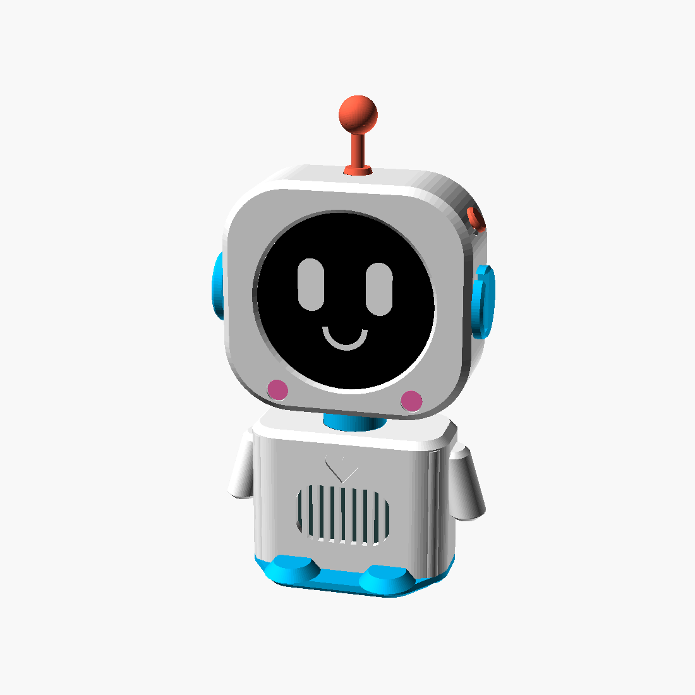

<div dir="rtl">

# HeyRobi 🤖 — רובוט AI קולי לילדים בקוד פתוח (ללא שרת!)



**HeyRobi** הופך לוח `Waveshare ESP32-S3-Touch-AMOLED-1.75` עם מסך מגע עגול ומארז מודפס בתלת־ממד לחבר AI קולי חכם, בטוח ומותאם אישית לילדים — **בחיבור ישיר ל-Google Gemini Live (`Gemini 3.8 Live`) מעל ה-WiFi הביתי, ללא שום צורך בשרת, ב-Docker או במחשב דולק!**

👉 **[כניסה לאשף ההתקנה והעיצוב בדפדפן (WebSerial Wizard)](https://ilaykid.github.io/robi-firmware/)**

---

## ✨ מה הופך את HeyRobi למיוחד?

- **אפס שרתים (Zero-Server On-Device):** בקר ה-`ESP32-S3` מתחבר ישירות ב-WebSocket מוצפן (`TLS/SSL`) אל `Google Gemini Live` עם אודיו דו-כיווני חי ב-`24kHz` ובאפר `512KB PSRAM` חלק וללא קטיעות.
- **תמיכה ב-Gemini 3.8 Live ומעקב מכסה יומית חינמית:** תמיכה מובנית ב-`gemini-3.8-live` כמודל ראשי עם הגדרת שפה `he-IL`, לצד גיבוי אוטומטי (`Failover`) למודלי `Gemini 2.5 Flash Native Audio` ו-`Gemini 2.0 Flash Live`, ומד ניצול מכסה יומית חי בפורטל ההורים.
- **אשף התקנה מלא בדפדפן בלחיצה אחת (WebSerial Wizard):** אין צורך להתקין `Python`, `ESP-IDF` או לקמפל קוד. פותחים את [אשף ההתקנה ב-Chrome/Edge](https://ilaykid.github.io/robi-firmware/), בוחרים קול (כולל השמעת דגימה חיה בדפדפן!), בוחרים עיצוב פנים מתוך 5 ערכות ניאון, מגדירים את שמות הילדים ותחומי העניין שלהם, מזינים WiFi ביתי וצורבים בלחיצה אחת בכבל USB-C!
- **ממשק ניהול אלחוטי להורים מהבית (`http://robi.local`):** אחרי ההתקנה הראשונית אין צורך לחבר כבל לעולם — רובי מריץ פורטל ניהול מקומי ברשת הביתית שמאפשר לשנות קול, מודל AI מועדף, עיצוב פנים, פרופילי ילדים, עוצמת שמע, בהירות ומפתח API ישירות מהטלפון עם עדכון חי מיידי על המסך.
- **פרופילי ילדים מותאמים אישית (0–3 ילדים):** לכל ילד/ה כפתור צבעוני על המסך העגול שנפתח ל-4 פעילויות מותאמות לגיל, פלוס נושאי שיחה ותחומי עניין מותאמים אישית שההורים מגדירים.
- **זיכרון שיחה מתמשך (`NVS`) על גבי השבב:** רובי זוכר עובדות חשובות שהילדים סיפרו לו בין שיחות וכיבויים, שומר אותן אך ורק בזיכרון ה-`Flash` הפנימי של המכשיר בבית, ומאפשר להורים לצפות בזיכרונות או למחוק אותם בכל עת.

---

## 🛠️ רשימת רכיבים (BOM) והזמנת מארז (הרכבה עצמית ב-10 דקות ללא הלחמות!)

אפשר לבנות את רובי בשני מסלולים לבחירתכם: **הדפסה עצמית של המארז** מתוך קבצי ה-`STL` במאגר, או **הזמנת מארז מודפס ומוכן בארץ** וחיבור מהיר של הלוח בקליק.

<!-- הערה למנהל המאגר: ניתן להחליף את קישורי ה-AliExpress למטה בקישורי Affiliate אישיים מ-portals.aliexpress.com (כגון https://s.click.aliexpress.com/e/...) ואת קישור המארז המודפס לקישור וואטסאפ/טופס הזמנה -->

| רכיב | דגם מדויק וקישור לרכישה | הערות |
|------|--------------------------|-------|
| **1. לוח פיתוח + מסך מגע עגול + רמקול (+ סוללה מומלצת)** | [**לחיפוש הדגם `Waveshare ESP32-S3-Touch-AMOLED-1.75` ב-AliExpress ↗**](https://s.click.aliexpress.com/e/_c3G1rMOJ) | הקישור מוביל לחיפוש המוצר ב-AliExpress (קישור שותפים). **מומלץ מאוד לבחור באפשרות הבאנדל שכוללת רמקול וסוללה (`With Speaker & Battery`)** ולוודא שבוחרים בלוח החשוף (ללא קופסת מתכת חיצונית) כדי שייכנס בול למארז של רובי. |
| **2. סוללה נטענת בנפרד (רק אם לא הזמנתם באנדל עם סוללה)** | [**לחיפוש הלוח והסוללה התואמת (`LiPo 3.7V MX1.25`) ב-AliExpress ↗**](https://s.click.aliexpress.com/e/_c3G1rMOJ) | מידה מומלצת עד `42×32×10 מ"מ` (`603040` / `803040` עם מחבר `MX1.25mm`). רובי עובד מצוין גם בחיבור קבוע לכבל USB-C ללא סוללה! |
| **3. מארז רובי מודפס בתלת־ממד** | **אפשרות א' (הדפסה עצמית):** קבצי `STL` + `OpenSCAD` בתיקייה [`case/Robi_v4/`](case/Robi_v4/README.md)<br>**אפשרות ב' (הזמנת מארז מודפס בארץ):** *(בקרוב — קישור ישיר להזמנת מארז מודפס איכותי במשלוח בארץ)* | כולל גוף קדמי/אחורי, אוזניות/אנטנה, כפתורי צד, רגליים ומעמד שולחני — נסגר עם 4 ברגים פשוטים ללא צורך בהלחמה. |

---

## 📊 כמה זמן שיחה חינם יש ביום? (מסלול ה-Free Tier של Google AI Studio)

רובי עובד עם מפתח `Gemini API` אישי שכל הורה מפיק בחינם ב-[Google AI Studio](https://aistudio.google.com/apikey) (ללא צורך בכרטיס אשראי במסלול החינמי):

- **כ-45 דקות שיחה קולית נטו ביום בחינם** (שקול לשעות של הפעלה יומית, שכן המכסה נספרת רק בשניות שבהן מתנהל דיבור פעיל ולא בזמן שרובי ממתין על השולחן).
- **מכסה יומית משולבת:** עד **500 סשנים ביום** ועד **1,000,000 טוקנים ביום** (מתאפסת מדי יום).
- **מנגנון בחירת מודל וגיבוי אוטומטי (`Auto Failover`):**
  1. `gemini-3.8-live` — מודל ברירת המחדל הראשי (עברית טבעית עם `he-IL`).
  2. `gemini-2.5-flash-native-audio-preview-12-2025` — מודל גיבוי מהיר.
  3. `gemini-2.0-flash-live-001` — מודל גיבוי נוסף.
- בפורטל ההורים (`http://robi.local`) מופיע **מד ניצול מכסה יומית חי** שמציג בדיוק כמה דקות, סשנים וטוקנים נוצלו היום בכל אחד מהמודלים.

---

## 🔒 פרטיות ואבטחת מידע (0% שרתים סיניים!)

בניגוד לרובוטים מסחריים שמעבירים את המיקרופון הביתי דרך שרתי תיווך בענן, **HeyRobi** תוכנן מהיסוד לשקיפות ופרטיות מוחלטת:

1. **אפס שרתי תיווך ואפס קוד ענן סיני:** כל שכבות ה-`MQTT` / `WebSocket` והעדכונים מרחוק של פרויקט הבסיס הוסרו לחלוטין בזמן הקימפול (`scripts/patch_xiaozhi.py`). בקובץ הבינארי קיימת כתובת ענן אחת ויחידה: `wss://generativelanguage.googleapis.com` של Google מעל `TLS` מוצפן עם תעודות השורש הרשמיות של ESP-IDF (`esp_crt_bundle_attach`).
2. **השמדה אוטומטית של סקטור הצריבה הזמני (`0x010000`):** בעת ההתקנה הראשונית מהדפדפן, ההגדרות מיובאות למחיצת ה-`NVS` הפנימית וסקטור המעבר `0x010000` נמחק פיזית (`0xFF`) משבב ה-`Flash` מיד בעלייה הראשונה.
3. **ללא שמירת סודות בדפדפן:** אשף ה-`WebSerial` לעולם לא שומר את מפתח ה-`Gemini` או את סיסמת ה-`WiFi` ב-`localStorage` של הדפדפן.
4. **הגנת `CSRF` בפורטל ההורים המקומי:** ממשק הניהול ב-`http://robi.local` זמין רק מתוך הרשת הביתית (`LAN`), לעולם אינו מחזיר את מפתח ה-API או תמלילי שיחה של הילדים ב-HTTP, ודורש אימות כותרות `X-Robi-Token` ו-`Origin` מקומי לכל פעולת שינוי.

---

## 🚀 התקנה ב-3 דקות (ללא שום ידע בתכנות!)

1. הפיקו מפתח API חינמי ב-[Google AI Studio](https://aistudio.google.com/apikey).
2. פתחו את **[אשף ההתקנה של HeyRobi](https://ilaykid.github.io/robi-firmware/)** בדפדפן **Google Chrome** או **Microsoft Edge** במחשב.
3. עברו על 5 השלבים באשף:
   - **שלב 1:** הדביקו את מפתח ה-Gemini, לחצו **בדוק מפתח** ובחרו מודל מועדף (`אוטומטי חכם — Gemini 3.8 Live` מומלץ).
   - **שלב 2:** בחרו שם לרובוט, שפה וקול (מומלץ: `Puck`) — לחצו **השמע דגימת קול** כדי לשמוע אותו חי!
   - **שלב 3:** בחרו עיצוב פנים מתוך 5 ערכות צבעים חיות (`Cyber Cyan`, `Solar Gold`, `Emerald Matrix`, `Cosmic Violet`, `Coral Cute`).
   - **שלב 4:** הגדירו נושאי שיחה מועדפים, 0–3 ילדים ו-4 כפתורי פעילות לכל ילד/ה.
   - **שלב 5:** הזינו את שם רשת ה-WiFi הביתית (`2.4GHz`) והסיסמה, חברו את רובי ב-USB-C ולחצו **צריבה מלאה לרובי חדש**!

---

## 📱 ניהול אלחוטי להורים אחרי ההתקנה

מרגע שרובי מחובר ל-WiFi הביתי, כל מכשיר באותה רשת (טלפון או מחשב) יכול לגשת אל:
- `http://robi.local` (או `http://robi` / כתובת ה-IP שמופיעה בלחיצה על הפינה השמאלית העליונה במסך של רובי)

ממשק הניהול המקומי מאפשר:
- צפייה חיה במודל הפעיל ובניצול המכסה היומית החינמית (דקות, סשנים וטוקנים) והחלפת מודל מועדף.
- שינוי קול, שפה וערכת צבעים לפנים (מתעדכן מיד על המסך של רובי!).
- עריכת שמות הילדים, גילאים, תחומי עניין ו-4 כפתורי הפעילות של כל ילד/ה.
- שליטה חיה בווליום ובבהירות וניקוי זיכרון השיחה של רובי.
- החלפת מפתח `Gemini API` בכל עת.

אם החלפתם נתב או לקחתם את רובי לבית אחר שבו ה-WiFi לא מוכר, רובי יפתח אוטומטית נקודת גישה אלחוטית בשם `Robi-XXXX` להגדרת רשת חדשה מהטלפון.

---

## 🧩 מבנה המאגר ופיתוח מקוד מקור

```text
robi-firmware/
├── docs/                        # אשף ההתקנה האינטראקטיבי בדפדפן + צורב WebSerial (GitHub Pages)
├── firmware/robi/               # מודולי הליבה העצמאיים של HeyRobi ב-C++:
│   ├── robi_config.{h,cc}       # ניהול הגדרות NVS + ייבוא ומחיקת 0x010000 + זיכרון שיחה ומכסת מודלים
│   ├── robi_gemini_live.{h,cc}  # לקוח WebSocket ישיר מול Google Gemini Live + באפר PSRAM 512KB
│   └── robi_http_portal.{h,cc}  # פורטל ניהול להורים בפורט 80 מוגן CSRF + משיב mDNS עבור robi.local
├── scripts/
│   ├── patch_xiaozhi.py         # סקריפט הזרקת השינויים מעל xiaozhi-esp32 v2.5.2 וניקוי ענן חיצוני
│   └── robi_ui.inc              # מנוע הפנים Cyber-Optic LVGL עם 5 ערכות עיצוב וכפתורי ילדים דינמיים
├── assets/                      # גופן Noto Sans Hebrew + סמלי הבעות
├── case/Robi_v4/                # קבצי הדפסה תלת-ממדית (STL + OpenSCAD) והוראות הרכבה
└── .github/workflows/build.yml  # בניית קושחה אוטומטית (ESP-IDF v6.1) + פריסת אשף ההתקנה ל-GitHub Pages
```

### קימפול עצמאי מקוד מקור (אופציונלי למפתחים)

המאגר כולל תהליך GitHub Actions אוטומטי ב-[`.github/workflows/build.yml`](.github/workflows/build.yml) שמייצר את קבצי ה-`.bin` המוכנים (`robi-full-heyrobby.bin` ו-`robi-full-hiesp.bin`) ומעלה אותם אוטומטית עם אשף ההתקנה ל-GitHub Pages בכל דחיפה ל-`main`.

לבנייה מקומית באמצעות Docker (`espressif/idf:v6.1`):

```bash
git clone --depth 1 --branch v2.5.2 https://github.com/78/xiaozhi-esp32 fw
python3 scripts/patch_xiaozhi.py fw heyrobby
docker run --rm -v "$PWD:/work" -w /work/fw \
  -e ROBI_TEXT_FONT=/work/assets/font_noto_sans_common_30_4.bin \
  -e ROBI_EMOJI_DIR=/work/assets/faces \
  espressif/idf:v6.1 bash -lc '
    source $IDF_PATH/export.sh &&
    python scripts/build.py waveshare/esp32-s3-touch-amoled-1.75 \
      --name esp32-s3-touch-amoled-1.75 --language he-IL
  '
```

---

## 📄 רישיון וקרדיטים

מופץ תחת רישיון **MIT** (ראו [`LICENSE`](LICENSE)).  
תשתית הדרייברים והאודיו מבוססת בהערכה רבה על פרויקט הקוד הפתוח המצוין [`78/xiaozhi-esp32`](https://github.com/78/xiaozhi-esp32) (רישיון MIT).

</div>

---

## 🌍 English Overview

**HeyRobi** is a 100% standalone, **zero-server** open-source AI companion robot for kids built around the **Waveshare ESP32-S3-Touch-AMOLED-1.75 (`SKU 31261`, `466×466` round touch AMOLED)** and a 3D-printable desktop body (`case/Robi_v4/`).

- **Direct ESP32-S3 → Google Gemini Live WebSocket (`Gemini 3.8 Live`):** Streams `16kHz` mic PCM up and plays `24kHz` native Gemini audio down through a `512KB` PSRAM jitter ring buffer — no Python backend, no cloud relay, no Chinese telemetry, and no PC required.
- **1-Click Browser Setup & WebSerial Installer ([Live Wizard](https://ilaykid.github.io/robi-firmware/)):** Configure your `GEMINI_API_KEY`, pick your preferred Gemini Live model, preview voices live in the browser, pick from **5 cyber-optic face color themes**, set up `0–3` child profiles with custom activity buttons, enter `2.4GHz` WiFi credentials, and flash everything over USB-C directly from Chrome/Edge.
- **Built-in Wireless Parent Portal (`http://robi.local`):** Track daily Free Tier usage across models and update voice, face theme, kids, volume, brightness, or API key anytime over home WiFi with instant live UI reload.
