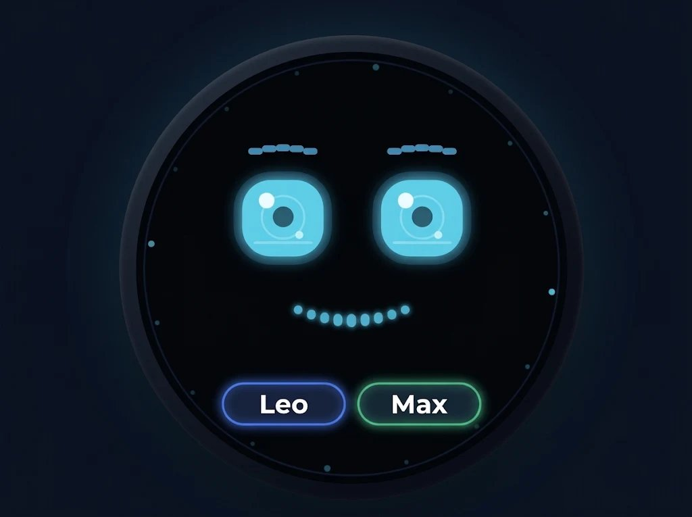

<p align="center">
  <strong>🌐 Language:</strong>
  <a href="#heyrobi--open-source-zero-server-ai-voice-robot-for-kids">🇬🇧 English</a> •
  <a href="#hebrew-readme">🇮🇱 עברית (Hebrew)</a> •
  <a href="https://ilaykid.github.io/robi-firmware/">🚀 Launch 1-Click Browser Setup Wizard</a>
</p>

# HeyRobi 🤖 — Open-Source Zero-Server AI Voice Robot for Kids

<p align="center">
  
</p>

**HeyRobi** turns a `Waveshare ESP32-S3-Touch-AMOLED-1.75` round touchscreen board and a 3D-printable desktop enclosure into a smart, kid-safe, personalized AI voice companion — **connecting directly to Google Gemini Live (`Gemini 3.8 Live`) over home WiFi, with zero server, zero Docker, and zero PC required!**

👉 **[Open the 1-Click Browser Setup & WebSerial Flasher](https://ilaykid.github.io/robi-firmware/)**

---

## ✨ What Makes HeyRobi Special?

- **100% Zero-Server On-Device Architecture:** The `ESP32-S3` connects directly over an encrypted `TLS/SSL` WebSocket to `Google Gemini Live`, streaming `16kHz` microphone PCM up and playing smooth `24kHz` native Gemini audio down through a `512KB PSRAM` jitter ring buffer — no Python backend, no relay cloud, and no always-on computer.
- **Gemini 3.8 Live + Automatic Model Failover & Free-Tier Tracker:** Built-in support for `gemini-3.8-live` as the primary model with automatic failover to `Gemini 2.5 Flash Native Audio` and `Gemini 2.0 Flash Live`, plus a live daily Free Tier usage monitor in the local Parent Portal.
- **1-Click Browser Setup Wizard (WebSerial — No Coding Needed):** No `Python`, no `ESP-IDF`, and no compiling required. Open the [Browser Setup Wizard in Chrome/Edge](https://ilaykid.github.io/robi-firmware/), preview voices live in your browser (with animated lip-sync!), choose from **5 robot face styles × 5 neon color themes** (25 combinations), configure kid profiles & custom topics, enter your home WiFi, and flash over USB-C in one click.
- **Wireless Local Parent Portal (`http://robi.local`):** After the initial USB-C flash, you never need a cable again — HeyRobi hosts a local web dashboard on your home LAN so parents can change voice, language (`en-US` / `he-IL`), preferred AI model, face style & colors, kid profiles, volume, brightness, or API key directly from their phone with instant live updates on the robot's screen.
- **Personalized Kid Profiles (`0–3` Kids):** Each child gets a color-coded touch button on the round AMOLED screen that opens 4 custom age-tailored activity buttons, plus parent-defined topics and interests woven naturally into conversations.
- **Persistent On-Chip Memory (`NVS`):** HeyRobi remembers important facts your kids share across sessions and power cycles, stored strictly inside the device's local `Flash` memory at home — parents can inspect or wipe memories anytime.

---

## 🛠️ Bill of Materials (BOM) & 3D Enclosure (10-Minute No-Solder Build!)

You can build HeyRobi with zero soldering by printing the open-source `STL` enclosure files included in this repository and snapping in the Waveshare board with a few standard `M2`/`M3` screws.

<!-- Maintainer note: AliExpress links below can use affiliate links (e.g. https://s.click.aliexpress.com/e/...) -->

| Component | Exact Model & Link | Notes |
|-----------|--------------------|-------|
| **1. Dev Board + Round Touch AMOLED + Speaker (+ Recommended Battery)** | [**Search `Waveshare ESP32-S3-Touch-AMOLED-1.75` on AliExpress ↗**](https://s.click.aliexpress.com/e/_c3G1rMOJ) | Opens an AliExpress product search (affiliate link). **Strongly recommended:** choose the bare board (`SKU 31261`, *without* the metal housing) in the **`With Speaker & Battery`** bundle so it fits straight into the HeyRobi enclosure. |
| **2. Rechargeable Battery (only if not bundled)** | [**Search Board & Compatible `LiPo 3.7V MX1.25` Battery on AliExpress ↗**](https://s.click.aliexpress.com/e/_c3G1rMOJ) | Recommended size up to `50×15×31 mm` (e.g., `103040` / `603040` / `803040` with protected 1S `MX1.25mm` 2-pin connector — **verify polarity**!). HeyRobi also runs great continuously over USB-C without a battery. |
| **3. 3D-Printable HeyRobi Enclosure** | **DIY 3D Print:** `STL` + parametric `OpenSCAD` source in [`case/Robi_v4/`](case/Robi_v4/README.md) | Includes front/back head, body with speaker grille, ears, antenna, side button pins, weighted base, and desktop stand — prints support-free (~136g PLA) and assembles with standard `M2`/`M3` screws, no soldering required. |

---

## 📊 How Much Free Voice Time Do You Get Per Day? (Google AI Studio Free Tier)

HeyRobi uses a personal `Gemini API` key that any parent can create for free in [Google AI Studio](https://aistudio.google.com/apikey) (no credit card required on the Free Tier):

- **~45 minutes of active net voice conversation per day for free** (which equals hours of real-world daily use, since quota is only consumed while actively speaking — not while HeyRobi sits idle on the desk).
- **Combined daily allowance:** up to **500 sessions/day** and **1,000,000 tokens/day** (resets daily at Google).
- **Smart Model Selection & Automatic Failover (`Auto Failover`):**
  1. `gemini-3.8-live` — Primary default model (natural multilingual voice including English `en-US` and Hebrew `he-IL`).
  2. `gemini-2.5-flash-native-audio-preview-12-2025` — Fast, reliable fallback model.
  3. `gemini-2.0-flash-live-001` — Secondary general fallback model.
- The local Parent Portal (`http://robi.local`) displays a **live daily usage tracker** estimating minutes, sessions, and tokens used per model.

---

## 🔒 Privacy & Security by Design (0% Third-Party / Chinese Cloud Servers!)

Unlike commercial smart toys that route your home microphone through opaque vendor relay clouds, **HeyRobi** was engineered from the ground up for transparency and privacy:

1. **Zero Relay Servers & Zero Upstream Cloud Code:** All upstream `MQTT`, `WebSocket`, and remote OTA telemetry layers from the base driver project are completely stripped at build time (`scripts/patch_xiaozhi.py`). The compiled binary contains **one and only one** cloud endpoint: Google's `wss://generativelanguage.googleapis.com` over encrypted `TLS` verified against the official ESP-IDF root CA bundle (`esp_crt_bundle_attach`).
2. **Automatic Physical Wipe of Provisioning Sector (`0x010000`):** During initial USB-C flashing from the browser, your configuration is imported into internal `NVS` on first boot and the temporary `0x010000` staging sector is physically erased (`0xFF`) from the `Flash` chip immediately.
3. **Zero Secrets Stored in Your Browser:** The `WebSerial` setup wizard never writes your `Gemini API` key or `WiFi` credentials to browser `localStorage` or sends them to any third-party server.
4. **`CSRF`-Protected Local Parent Portal:** The dashboard at `http://robi.local` is only reachable inside your home `LAN`, never exposes your API key or kids' transcripts over HTTP, and enforces `X-Robi-Token` and local `Origin` header checks on every write request.

---

## 🚀 3-Minute Setup (Zero Coding Required!)

1. Generate a free API key at [Google AI Studio](https://aistudio.google.com/apikey).
2. Open the **[HeyRobi Browser Setup Wizard](https://ilaykid.github.io/robi-firmware/)** in **Google Chrome** or **Microsoft Edge** on a desktop/laptop.
3. Walk through the 5 quick steps:
   - **Step 1:** Paste your Gemini API key, click **Verify Key**, and pick your preferred model (`Smart Auto — Gemini 3.8 Live` recommended).
   - **Step 2:** Choose your robot's name, language (`English en-US` or `Hebrew he-IL`), and voice (`Puck` recommended) — click **Play Live Voice Sample** to hear it speak with live lip-sync!
   - **Step 3:** Pick a robot face style and neon color theme (`Cyber Cyan`, `Solar Gold`, `Emerald Matrix`, `Cosmic Violet`, `Coral Cute`).
   - **Step 4:** Add custom parent topics, `0–3` kid profiles, and 4 touch activity buttons per child.
   - **Step 5:** Enter your `2.4GHz` home WiFi credentials, plug HeyRobi in via USB-C, and click **Full Flash for a New Robi**!

---

## 📱 Wireless Parent Management After Setup

Once HeyRobi connects to your home WiFi, any phone or computer on the same network can open:
- `http://robi.local` (or `http://robi`, or the IP address shown when tapping the top-left corner of HeyRobi's screen)

From the local Parent Portal you can:
- Monitor the active AI model and estimated daily Free Tier usage (minutes, sessions, tokens) and switch models.
- Change voice, language, face style, and color theme (updates live on HeyRobi's display immediately!).
- Edit kid profiles, ages, interests, custom topics, and all 4 activity buttons per child.
- Adjust volume and brightness live, and view or clear HeyRobi's on-chip conversation memories.
- Rotate your `Gemini API` key anytime.

If you change routers or bring HeyRobi to another home with an unknown WiFi network, it automatically opens a `Robi-XXXX` WiFi hotspot so you can configure a new network from your phone.

---

## 🧩 Repository Structure & Building from Source

```text
robi-firmware/
├── docs/                        # Interactive Browser Setup Wizard + WebSerial Flasher (GitHub Pages)
├── firmware/robi/               # Modular HeyRobi C++ core modules:
│   ├── robi_config.{h,cc}       # NVS config storage + safe UTF-8 repair/truncation + memory & model quota tracking
│   ├── robi_gemini_live.{h,cc}  # Direct Google Gemini Live WebSocket client + low-latency speech turn sync
│   ├── robi_audio_sync.h        # Sample-accurate ring buffer (512KB PSRAM), DSP & adaptive speech-end tracking
│   ├── robi_face_math.h         # Procedural robot face math, 5 face styles × 5 color themes & emotion expressions
│   ├── robi_display_ui.h        # LVGL round AMOLED display controller + lock-free 20Hz lip-sync
│   ├── robi_http_portal.{h,cc}  # Port-80 local Parent Portal with CSRF protection & live session reload
│   ├── robi_portal_html.h       # Self-contained responsive Parent Portal HTML served from flash
│   ├── robi_mdns.h              # Standards-compliant mDNS + NSEC responder (RFC 6762) for robi.local
│   └── robi_utf8.h              # Safe UTF-8 validation & truncation for multilingual text and emojis
├── scripts/
│   ├── patch_xiaozhi.py         # Patches xiaozhi-esp32 v2.5.2 into standalone HeyRobi & strips third-party clouds
│   └── robi_ui.inc              # Clean display UI include hook for the Waveshare board
├── assets/                      # Noto Sans (Latin + Hebrew) font binary + emotion face sprites
├── case/Robi_v4/                # 3D-printable enclosure (STL + OpenSCAD) & assembly guide
└── .github/workflows/build.yml  # Automated ESP-IDF v6.1 firmware CI build + GitHub Pages deployment
```

### Local Source Build (Optional for Developers)

The repository includes an automated GitHub Actions workflow in [`.github/workflows/build.yml`](.github/workflows/build.yml) that compiles ready-to-flash `.bin` images (`robi-full-heyrobby.bin` and `robi-full-hiesp.bin`) and publishes them alongside the Setup Wizard to GitHub Pages on every push to `main`.

To build locally with Docker (`espressif/idf:v6.1`):

```bash
git clone --depth 1 --branch v2.5.2 https://github.com/78/xiaozhi-esp32 fw
python3 scripts/patch_xiaozhi.py fw heyrobby
docker run --rm -v "$PWD:/work" -w /work/fw \
  -e ROBI_TEXT_FONT=/work/assets/font_noto_sans_common_30_4.bin \
  -e ROBI_EMOJI_DIR=/work/assets/faces \
  espressif/idf:v6.1 bash -lc '
    source $IDF_PATH/export.sh &&
    python scripts/build.py waveshare/esp32-s3-touch-amoled-1.75 \
      --name esp32-s3-touch-amoled-1.75 --language he-IL
  '
```

---

## 📄 License & Credits

Released under the **MIT License** (see [`LICENSE`](LICENSE)).  
Hardware drivers and audio foundation are gratefully built on top of the awesome open-source [`78/xiaozhi-esp32`](https://github.com/78/xiaozhi-esp32) project (MIT License).

---

<a id="hebrew-readme"></a>

<div dir="rtl">

<p align="center">
  <a href="#heyrobi--open-source-zero-server-ai-voice-robot-for-kids">🇬🇧 חזרה לגרסה באנגלית (Back to English)</a> •
  <a href="https://ilaykid.github.io/robi-firmware/?lang=he">🚀 כניסה לאשף ההתקנה בעברית</a>
</p>

# HeyRobi 🤖 — רובוט AI קולי לילדים בקוד פתוח (ללא שרת!)

**HeyRobi** הופך לוח `Waveshare ESP32-S3-Touch-AMOLED-1.75` עם מסך מגע עגול ומארז מודפס בתלת־ממד לחבר AI קולי חכם, בטוח ומותאם אישית לילדים — **בחיבור ישיר ל-Google Gemini Live (`Gemini 3.8 Live`) מעל ה-WiFi הביתי, ללא שום צורך בשרת, ב-Docker או במחשב דולק!**

👉 **[כניסה לאשף ההתקנה והעיצוב בדפדפן בעברית (WebSerial Wizard)](https://ilaykid.github.io/robi-firmware/?lang=he)**

---

## ✨ מה הופך את HeyRobi למיוחד?

- **אפס שרתים (Zero-Server On-Device):** בקר ה-`ESP32-S3` מתחבר ישירות ב-WebSocket מוצפן (`TLS/SSL`) אל `Google Gemini Live` עם אודיו דו-כיווני חי ב-`24kHz` ובאפר `512KB PSRAM` חלק וללא קטיעות.
- **תמיכה ב-Gemini 3.8 Live ומעקב מכסה יומית חינמית:** תמיכה מובנית ב-`gemini-3.8-live` כמודל ראשי עם תמיכה מלאה בעברית (`he-IL`) ובאנגלית (`en-US`), לצד גיבוי אוטומטי (`Failover`) למודלי `Gemini 2.5 Flash Native Audio` ו-`Gemini 2.0 Flash Live`, ומד ניצול מכסה יומית חי בפורטל ההורים.
- **אשף התקנה מלא בדפדפן בלחיצה אחת (WebSerial Wizard):** אין צורך להתקין `Python`, `ESP-IDF` או לקמפל קוד. פותחים את [אשף ההתקנה ב-Chrome/Edge](https://ilaykid.github.io/robi-firmware/?lang=he), בוחרים קול (כולל השמעת דגימה חיה בדפדפן!), בוחרים עיצוב פנים מתוך 5 סגנונות × 5 ערכות ניאון, מגדירים את שמות הילדים ותחומי העניין שלהם, מזינים WiFi ביתי וצורבים בלחיצה אחת בכבל USB-C!
- **ממשק ניהול אלחוטי להורים מהבית (`http://robi.local`):** אחרי ההתקנה הראשונית אין צורך לחבר כבל לעולם — רובי מריץ פורטל ניהול מקומי ברשת הביתית שמאפשר לשנות קול, מודל AI מועדף, עיצוב פנים, פרופילי ילדים, עוצמת שמע, בהירות ומפתח API ישירות מהטלפון עם עדכון חי מיידי על המסך.
- **פרופילי ילדים מותאמים אישית (0–3 ילדים):** לכל ילד/ה כפתור צבעוני על המסך העגול שנפתח ל-4 פעילויות מותאמות לגיל, פלוס נושאי שיחה ותחומי עניין מותאמים אישית שההורים מגדירים.
- **זיכרון שיחה מתמשך (`NVS`) על גבי השבב:** רובי זוכר עובדות חשובות שהילדים סיפרו לו בין שיחות וכיבויים, שומר אותן אך ורק בזיכרון ה-`Flash` הפנימי של המכשיר בבית, ומאפשר להורים לצפות בזיכרונות או למחוק אותם בכל עת.

---

## 🛠️ רשימת רכיבים (BOM) והזמנת מארז (הרכבה עצמית ב-10 דקות ללא הלחמות!)

אפשר לבנות את רובי בשני מסלולים לבחירתכם: **הדפסה עצמית של המארז** מתוך קבצי ה-`STL` במאגר, או **הזמנת מארז מודפס ומוכן** וחיבור מהיר של הלוח בקליק.

| רכיב | דגם מדויק וקישור לרכישה | הערות |
|------|--------------------------|-------|
| **1. לוח פיתוח + מסך מגע עגול + רמקול (+ סוללה מומלצת)** | [**לחיפוש הדגם `Waveshare ESP32-S3-Touch-AMOLED-1.75` ב-AliExpress ↗**](https://s.click.aliexpress.com/e/_c3G1rMOJ) | הקישור מוביל לחיפוש המוצר ב-AliExpress (קישור שותפים). **מומלץ מאוד לבחור באפשרות הבאנדל שכוללת רמקול וסוללה (`With Speaker & Battery`)** ולוודא שבוחרים בלוח החשוף (ללא קופסת מתכת חיצונית) כדי שייכנס בול למארז של רובי. |
| **2. סוללה נטענת בנפרד (רק אם לא הזמנתם באנדל עם סוללה)** | [**לחיפוש הלוח והסוללה התואמת (`LiPo 3.7V MX1.25`) ב-AliExpress ↗**](https://s.click.aliexpress.com/e/_c3G1rMOJ) | מידה מומלצת עד `50×15×31 מ"מ` (`103040` / `603040` / `803040` עם מחבר `MX1.25mm` — **בדקו קוטביות!**). רובי עובד מצוין גם בחיבור קבוע לכבל USB-C ללא סוללה! |
| **3. מארז רובי מודפס בתלת־ממד** | **אפשרות א' (הדפסה עצמית):** קבצי `STL` + `OpenSCAD` בתיקייה [`case/Robi_v4/`](case/Robi_v4/README.md#hebrew-guide)<br>**אפשרות ב' (הזמנת מארז מודפס בארץ):** *(בקרוב — קישור ישיר להזמנת מארז מודפס איכותי במשלוח בארץ)* | כולל גוף קדמי/אחורי, אוזניות/אנטנה, כפתורי צד ובסיס יציב — מודפס ללא תמיכות ונסגר בברגים פשוטים ללא צורך בהלחמה. |

---

## 📊 כמה זמן שיחה חינם יש ביום? (מסלול ה-Free Tier של Google AI Studio)

רובי עובד עם מפתח `Gemini API` אישי שכל הורה מפיק בחינם ב-[Google AI Studio](https://aistudio.google.com/apikey) (ללא צורך בכרטיס אשראי במסלול החינמי):

- **כ-45 דקות שיחה קולית נטו ביום בחינם** (שקול לשעות של הפעלה יומית, שכן המכסה נספרת רק בשניות שבהן מתנהל דיבור פעיל ולא בזמן שרובי ממתין על השולחן).
- **מכסה יומית משולבת:** עד **500 סשנים ביום** ועד **1,000,000 טוקנים ביום** (מתאפסת מדי יום).
- **מנגנון בחירת מודל וגיבוי אוטומטי (`Auto Failover`):**
  1. `gemini-3.8-live` — מודל ברירת המחדל הראשי (עברית טבעית עם `he-IL` ואנגלית עם `en-US`).
  2. `gemini-2.5-flash-native-audio-preview-12-2025` — מודל גיבוי מהיר.
  3. `gemini-2.0-flash-live-001` — מודל גיבוי נוסף.
- בפורטל ההורים (`http://robi.local`) מופיע **מד ניצול מכסה יומית חי** שמציג בדיוק כמה דקות, סשנים וטוקנים נוצלו היום בכל אחד מהמודלים.

---

## 🔒 פרטיות ואבטחת מידע (0% שרתים סיניים!)

בניגוד לרובוטים מסחריים שמעבירים את המיקרופון הביתי דרך שרתי תיווך בענן, **HeyRobi** תוכנן מהיסוד לשקיפות ופרטיות מוחלטת:

1. **אפס שרתי תיווך ואפס קוד ענן סיני:** כל שכבות ה-`MQTT` / `WebSocket` והעדכונים מרחוק של פרויקט הבסיס הוסרו לחלוטין בזמן הקימפול (`scripts/patch_xiaozhi.py`). בקובץ הבינארי קיימת כתובת ענן אחת ויחידה: `wss://generativelanguage.googleapis.com` של Google מעל `TLS` מוצפן עם תעודות השורש הרשמיות של ESP-IDF (`esp_crt_bundle_attach`).
2. **השמדה אוטומטית של סקטור הצריבה הזמני (`0x010000`):** בעת ההתקנה הראשונית מהדפדפן, ההגדרות מיובאות למחיצת ה-`NVS` הפנימית וסקטור המעבר `0x010000` נמחק פיזית (`0xFF`) משבב ה-`Flash` מיד בעלייה הראשונה.
3. **ללא שמירת סודות בדפדפן:** אשף ה-`WebSerial` לעולם לא שומר את מפתח ה-`Gemini` או את סיסמת ה-`WiFi` ב-`localStorage` של הדפדפן.
4. **הגנת `CSRF` בפורטל ההורים המקומי:** ממשק הניהול ב-`http://robi.local` זמין רק מתוך הרשת הביתית (`LAN`), לעולם אינו מחזיר את מפתח ה-API או תמלילי שיחה של הילדים ב-HTTP, ודורש אימות כותרות `X-Robi-Token` ו-`Origin` מקומי לכל פעולת שינוי.

---

## 🚀 התקנה ב-3 דקות (ללא שום ידע בתכנות!)

1. הפיקו מפתח API חינמי ב-[Google AI Studio](https://aistudio.google.com/apikey).
2. פתחו את **[אשף ההתקנה של HeyRobi](https://ilaykid.github.io/robi-firmware/?lang=he)** בדפדפן **Google Chrome** או **Microsoft Edge** במחשב.
3. עברו על 5 השלבים באשף:
   - **שלב 1:** הדביקו את מפתח ה-Gemini, לחצו **בדוק מפתח** ובחרו מודל מועדף (`אוטומטי חכם — Gemini 3.8 Live` מומלץ).
   - **שלב 2:** בחרו שם לרובוט, שפה וקול (מומלץ: `Puck`) — לחצו **השמע דגימת קול** כדי לשמוע אותו חי!
   - **שלב 3:** בחרו עיצוב פנים מתוך 5 סגנונות ו-5 ערכות צבעים חיות (`Cyber Cyan`, `Solar Gold`, `Emerald Matrix`, `Cosmic Violet`, `Coral Cute`).
   - **שלב 4:** הגדירו נושאי שיחה מועדפים, 0–3 ילדים ו-4 כפתורי פעילות לכל ילד/ה.
   - **שלב 5:** הזינו את שם רשת ה-WiFi הביתית (`2.4GHz`) והסיסמה, חברו את רובי ב-USB-C ולחצו **צריבה מלאה לרובי חדש**!

---

## 📱 ניהול אלחוטי להורים אחרי ההתקנה

מרגע שרובי מחובר ל-WiFi הביתי, כל מכשיר באותה רשת (טלפון או מחשב) יכול לגשת אל:
- `http://robi.local` (או `http://robi` / כתובת ה-IP שמופיעה בלחיצה על הפינה השמאלית העליונה במסך של רובי)

ממשק הניהול המקומי מאפשר:
- צפייה חיה במודל הפעיל ובניצול המכסה היומית החינמית (דקות, סשנים וטוקנים) והחלפת מודל מועדף.
- שינוי קול, שפה וערכת צבעים לפנים (מתעדכן מיד על המסך של רובי!).
- עריכת שמות הילדים, גילאים, תחומי עניין ו-4 כפתורי הפעילות של כל ילד/ה.
- שליטה חיה בווליום ובבהירות וניקוי זיכרון השיחה של רובי.
- החלפת מפתח `Gemini API` בכל עת.

אם החלפתם נתב או לקחתם את רובי לבית אחר שבו ה-WiFi לא מוכר, רובי יפתח אוטומטית נקודת גישה אלחוטית בשם `Robi-XXXX` להגדרת רשת חדשה מהטלפון.

---

## 📄 רישיון וקרדיטים

מופץ תחת רישיון **MIT** (ראו [`LICENSE`](LICENSE)).  
תשתית הדרייברים והאודיו מבוססת בהערכה רבה על פרויקט הקוד הפתוח המצוין [`78/xiaozhi-esp32`](https://github.com/78/xiaozhi-esp32) (רישיון MIT).

</div>
