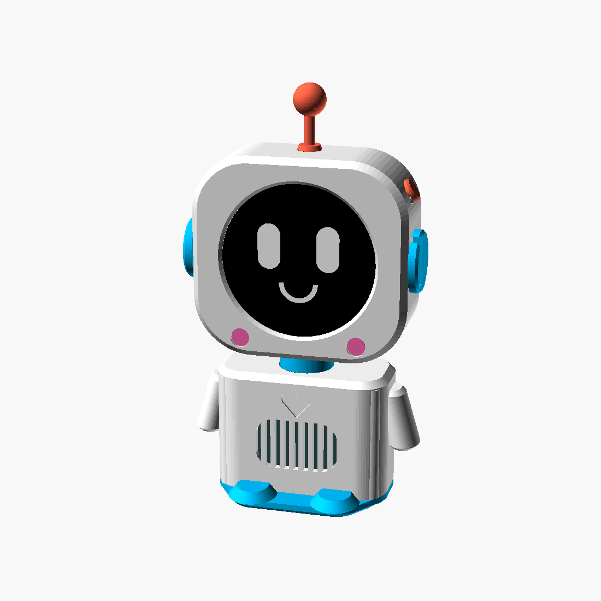

<p align="center">
  <strong>🌐 Language:</strong>
  <a href="#robi--3d-printable-enclosure-for-waveshare-esp32-s3-touch-amoled-175-v4-sturdy-robi">🇬🇧 English</a> •
  <a href="#hebrew-guide">🇮🇱 עברית (Hebrew)</a> •
  <a href="../../README.md">⬅️ Back to Main README</a>
</p>

# Robi – 3D-Printable Enclosure for Waveshare ESP32-S3-Touch-AMOLED-1.75 (v4, "Sturdy Robi")



A 3D-printable desktop enclosure for the **standard bare Waveshare ESP32-S3-Touch-AMOLED-1.75 board (no metal case, SKU 31261)**.  
It keeps the same friendly character and board clearances as v3.1 (touchscreen, PWR, BOOT, USB-C, microSD, dual microphones), rebuilt from the ground up to survive everyday handling by kids.  
Board dimensions were taken from Waveshare's mechanical drawing and should be test-fitted on your printer first — print `robi_fit_test.stl` and the two head halves before printing the rest.

**Dimensions:** Head `72×68×28 mm`, body `62×40×42 mm` (`82 mm` wide with arms), base `78×78 mm`, total height `~143 mm` including the antenna.

## What Changed in v4 (2026-10-29)

| Feature | v3.1 | v4 |
|---|---|---|
| Wall thickness | 2.2 mm | **3.2 mm** |
| Neck | 14 mm glued tube | **30 mm diameter collar**; two `M3×20` screws clamp head, neck collar, and body together |
| Base | 3 mm feet | **8 mm thick 78×78 mm plate**, extending 24 mm behind the body, with a ballast pocket and 4× `M3` screws |
| Ears | 3 mm, 2 mm pins | 5 mm thick, 3 mm pins |
| Antenna | 3.4 mm stem | 6 mm stem, 13 mm ball, seated in a chamfered socket |
| Tip-over resistance | Tips backward at ~35 g push at screen center | **~89 g**, and **~110 g** (3× stronger) with 44 g ballast in the pocket |
| Weight | ~99 g | ~186 g without ballast (including board, battery, and speaker) |

## Folder Contents

| File | Description | Print Orientation | Est. PLA |
|---|---|---|---|
| `robi_fit_test.stl` | **Print first!** Test ring to verify display glass fit | As oriented | 3 g |
| `robi_head_front.stl` | Front head bezel (face) | Face down on build plate (pre-oriented) | 12 g |
| `robi_head_back.stl` | Rear head shell with screw standoffs | Back down on build plate (pre-oriented) | 25 g |
| `robi_body.stl` | Body with speaker grille, heart detail, and arms | Upside-down, top face on build plate (pre-oriented) | 37 g |
| `robi_base.stl` | Base with ballast pocket, battery tray, and speaker posts | As oriented | 49 g (at 100% infill) |
| `robi_neck.stl` | Neck collar | As oriented | 5 g |
| `robi_antenna.stl` | Antenna | Standing on its pin | 2 g |
| `robi_ear_left.stl` | Left ear with ring around USB-C port | Pins facing up | 1 g |
| `robi_ear_right.stl` | Right ear with microSD access window | Pins facing up | 1 g |
| `robi_pwr_button.stl` | Standard-length button pin (**print 2:** for `PWR` and `BOOT`) | Standing on its cap | 0.3 g |
| `robi_pwr_button_short.stl`, `robi_pwr_button_long.stl` | Same pin, `0.4 mm` shorter or longer for fine tuning | Standing on its cap | 0.3 g |
| `robi.scad` | Parametric OpenSCAD source file | — | — |

**Total filament: ~136 g PLA.** All parts print **without supports**.

## Board Access

| Board Feature | Access |
|---|---|
| Touchscreen | 47 mm bevelled window — a finger reaches nearly to the bottom edge |
| `PWR` button | Orange pin at upper-right corner: tap to power on, hold 4 seconds to power off |
| `BOOT` button | Orange pin at lower-right corner: tap to start/stop a conversation. **Holding during power-on enters WiFi setup/boot mode**, so wait until the face appears |
| USB-C | Through the left ear, `14.4×8.8 mm` cutout |
| microSD slot | Through the window in the right ear (use tweezers) |
| Microphones | Two acoustic holes on the back of the head |

## Recommended Print Settings

- **Material:** PLA or PETG.
- **Base (`robi_base.stl`):** **100% infill** (or at least 50%) — it acts as Robi's counterweight.
- **All other parts:** 4 perimeters/walls, 20% infill, `0.2 mm` layer height (`0.16 mm` recommended for `robi_head_front.stl`, with a clean first layer).
- **Suggested color scheme:** White head & body; sky blue ears, neck, and base; orange antenna and button pins.

## Required Hardware

| Item | Qty |
|---|---|
| Waveshare ESP32-S3-Touch-AMOLED-1.75 (SKU 31261) | 1 |
| 2030 speaker, 8Ω 2W (`30×20×6.8 mm`), cable ≥ 10 cm | 1 |
| Protected 1S LiPo battery (see dimensions below) | 1 |
| **`M2×16`** machine screws (board to head — machine screws, not self-tapping) | 3 |
| **`M2×20`** screws (joining head front & back) | 4 |
| **`M3×20`** screws (clamping head, neck, and body) | 2 |
| **`M3×12`** screws (base to body, from underneath) | 4 |
| Base ballast: coins or steel washers, up to 44 g | — |
| CA glue (superglue) for ears & antenna (optional for ballast) | A little |
| Self-adhesive silicone feet under the base | 4 |

### Compatible Battery Dimensions

| Dimension (including protection PCB) | Maximum |
|---|---|
| Length (side where wires exit) | 50 mm |
| Thickness | 15 mm |
| Height (standing upright) | 31 mm |
| Wire length to connector | ≥ 12 cm |
| Connector | 2-pin `MX1.25` — **polarity MUST match the board!** |

Fits `103040` (`1000–1200 mAh`), and tightly fits `104050` (`1500–1800 mAh`) if its standing height is ≤ 31 mm.

## Assembly Order

1. **Fit test:** Print `robi_fit_test.stl` and place the board face-down into it. The glass should drop in smoothly without force or rattle. If needed, tweak `pocket_d` in `robi.scad`.
2. **Dry-fit the head:** Print both head halves, test-fit the board, confirm USB-C and microSD align with the openings, and check that the button pins produce a crisp click.
3. **Buttons:** Slide a pin from the side into each of the two half-channels in `robi_head_front`. The cap faces outside; the small collar sits inside the wider section of the channel. Choose the length per button independently:
   - Pressing does nothing → use `long`.
   - `PWR` acts stuck/pressed continuously → use `short`.
   - **`BOOT`: if Robi fails to boot (black screen), the pin is too long** because holding `BOOT` at power-on puts the ESP32-S3 into flash download mode → use `short`.
4. **Display:** Seat the board into `robi_head_front`. Looking at the face from the front, the USB-C port points **left**.
5. **Speaker:** Slide it up between the internal rails inside `robi_body` from the bottom, speaker face toward the front grille.
6. **Cables:** Route the speaker and battery wires upward through the rear-top opening of the body and through the neck collar.
7. **Neck:** Place `robi_neck` on top of the body (wide side down) aligning its two holes with the body holes. Seat `robi_head_back` on top (the neck boss drops into the recess in the head floor). Drive the two **`M3×20`** screws from inside the head down through the neck into the body and tighten.
8. **Wiring:** Plug the speaker (`SPK`) and battery (`BAT`) connectors into the board. **Double-check battery polarity before connecting!**
9. **Close the head:** Slide `robi_head_front` (with board & button pins) onto `robi_head_back`. Fasten the 4 **`M2×20`** corner screws from the rear, then the 3 **`M2×16`** screws through the standoffs into the board's brass inserts. Snug until seated — **do not overtighten**.
10. **Ballast & battery:** Glue coins or steel washers into the `6 mm` deep recess in `robi_base` (under and behind the battery) flush with the top surface. Stand the battery on the base behind the low retaining lip.
11. **Base:** Fasten `robi_base` to the body from underneath with 4 **`M3×12`** screws. Stick on the 4 silicone feet.
12. **Details:** Glue the ears (pins into the side holes of the head) and the antenna into its top socket.

**Replacing the battery later:** Remove the 4 bottom `M3×12` screws for instant access to the battery bay. To unplug the battery cable from the board, remove the 4 rear head screws and pull the wire back through the neck.

## Customizable Parameters in `robi.scad`

- `pocket_d`: Display glass pocket diameter.
- `pwr_tip_r`, `pwr_adj`: Button pin switch contact point and pin lengths.
- `wall`: Shell wall thickness.
- `base_w`, `base_d`, `base_t`, `ballast`: Base dimensions and counterweight pocket.
- `neck_d`, `neck_gap`: Neck diameter and visible collar gap.
- `clr`: General printer clearance tolerance.

Export a single part after modifying parameters:
```bash
openscad -o robi_body.stl -D 'part="body"' robi.scad
```

## Important Notes

- **Stability:** Tip-over numbers assume a horizontal push at the center of the screen. Robi is still relatively light, so adding the ballast and silicone feet makes a huge difference. A light touch is all the AMOLED needs.
- **USB-C cables:** Because the wall and ear are thicker, the USB-C plug needs ~10 mm of reach. Most standard cables with plug bodies up to `14×8.5 mm` fit cleanly; extra-chunky braided plug housings may not seat fully.
- **microSD:** The card sits recessed inside the right ear; insert and eject using tweezers.
- **WiFi:** The ESP32-S3 only connects to `2.4GHz` networks and has a compact onboard antenna — place Robi within good 2.4GHz coverage (PLA/PETG plastic does not block WiFi).
- **Battery safety:** Use only a LiPo cell with an integrated protection circuit, verify polarity before plugging in, and never leave a closed enclosure charging unattended. No screws point into the battery compartment.

---

<a id="hebrew-guide"></a>

<div dir="rtl">

<p align="center">
  <a href="#robi--3d-printable-enclosure-for-waveshare-esp32-s3-touch-amoled-175-v4-sturdy-robi">🇬🇧 חזרה לגרסה באנגלית (Back to English)</a> •
  <a href="../../README.md#hebrew-readme">⬅️ חזרה למדריך הראשי</a>
</p>

# רובי (Robi) – מארז רובוט ל-Waveshare ESP32-S3-Touch-AMOLED-1.75 (גרסה 4, "רובי החסון")

מארז מודפס בתלת־ממד ללוח **ESP32-S3-Touch-AMOLED-1.75 בגרסה הרגילה, בלי קופסה (מק"ט 31261)**.
אותה דמות ואותן התאמות ללוח כמו ב-v3.1 (המסך, PWR, BOOT, USB-C, microSD, מיקרופונים), אבל בנוי להחזיק מעמד מול ילדים.
מידות הלוח נלקחו משרטוט המידות של Waveshare ולא אומתו מחדש מאז, ולכן מדפיסים קודם את `fit_test` ואת שני חלקי הראש.

**גודל:** ראש 72×68×28 מ"מ, גוף 62×40×42 (82 מ"מ רוחב עם הידיים), בסיס 78×78, גובה כ־143 מ"מ כולל האנטנה.

## מה השתנה ב-v4 (29.10.2026)
| מה | ב-v3.1 | ב-v4 |
|---|---|---|
| קירות | 2.2 מ"מ | **3.2 מ"מ** |
| צוואר | צינור בקוטר 14 מ"מ, מודבק | **חוליה בקוטר 30 מ"מ**. שני ברגי M3×20 מהדקים ראש, חוליה וגוף |
| בסיס | 3 מ"מ, רגליים | **לוח בעובי 8 מ"מ, 78×78**, בולט 24 מ"מ מאחורי הגוף. כיס למשקולת. 4 ברגי M3 |
| אוזניים | 3 מ"מ, פינים של 2 מ"מ | 5 מ"מ, פינים של 3 מ"מ |
| אנטנה | גבעול 3.4 מ"מ | גבעול 6 מ"מ, כדור 13 מ"מ, יושבת בשקע עם שיפוע |
| יציבות | נופל אחורה מדחיפה של כ־35 גרם במרכז המסך | **כ־89 גרם**, ועם 44 גרם משקולת בכיס **כ־110 גרם** (פי 3) |
| משקל | כ־99 גרם | כ־186 גרם בלי משקולת (כולל הלוח, הסוללה והרמקול) |

## תוכן התיקייה
| קובץ | מה זה | כיוון הדפסה | PLA משוער |
|---|---|---|---|
| `robi_fit_test.stl` | **להדפיס ראשון!** טבעת ניסיון לבדיקת התאמת הזכוכית | כמו שהוא | 3 גרם |
| `robi_head_front.stl` | חזית הראש (פנים) | הפנים על המשטח (כבר מסובב) | 12 גרם |
| `robi_head_back.stl` | גב הראש עם עמודי הברגים | הגב על המשטח (כבר מסובב) | 25 גרם |
| `robi_body.stl` | גוף עם רשת לרמקול, לב וידיים | הפוך, החלק העליון על המשטח (כבר מסובב) | 37 גרם |
| `robi_base.stl` | בסיס עם כיס למשקולת, מגש לסוללה ועמודים לרמקול | כמו שהוא | 49 גרם (במילוי 100%) |
| `robi_neck.stl` | חוליית הצוואר | כמו שהוא | 5 גרם |
| `robi_antenna.stl` | אנטנה | עומדת על הפין | 2 גרם |
| `robi_ear_left.stl` | אוזן שמאל, טבעת סביב ה-USB-C | הפינים למעלה | 1 גרם |
| `robi_ear_right.stl` | אוזן ימין, עם חלון לכרטיס microSD | הפינים למעלה | 1 גרם |
| `robi_pwr_button.stl` | פין לחיצה, אורך רגיל. **מדפיסים 2:** ל-PWR ול-BOOT | עומד על הכובע | 0.3 גרם |
| `robi_pwr_button_short.stl`, `robi_pwr_button_long.stl` | אותו פין, קצר או ארוך ב־0.4 מ"מ | עומד על הכובע | 0.3 גרם |
| `robi.scad` | קובץ המקור הפרמטרי (OpenSCAD) | — | — |

**סה"כ כ־136 גרם PLA.** כל החלקים מודפסים בלי תמיכות (supports).

## גישה לכל רכיבי הלוח
| רכיב בלוח | איך מגיעים אליו |
|---|---|
| מסך מגע | חלון של 47 מ"מ עם שיפוע. אצבע מגיעה כמעט עד הקצה התחתון |
| כפתור PWR | פין כתום בפינה הימנית העליונה. מדליק, והחזקה של 4 שניות מכבה |
| כפתור BOOT | פין כתום בפינה הימנית התחתונה. לחיצה מתחילה או עוצרת שיחה. **לחיצה בזמן ההדלקה פותחת הגדרת Wi-Fi**, אז מחכים שהפרצוף יופיע |
| USB-C | דרך האוזן השמאלית, פתח 14.4×8.8 מ"מ |
| חריץ microSD | דרך החלון באוזן הימנית, עם פינצטה |
| מיקרופונים | שני חורים בגב הראש |

## הגדרות הדפסה
- **חומר:** PLA או PETG.
- **בסיס:** **מילוי 100%** (או לפחות 50%). הוא המשקולת של רובי.
- **שאר החלקים:** 4 קירות, מילוי 20%, שכבה 0.2 מ"מ. לחזית הראש עדיף 0.16, והשכבה הראשונה צריכה להיות נקייה.
- **צבעים מומלצים:** ראש וגוף לבנים. אוזניים, צוואר ובסיס בתכלת. אנטנה ופינים בכתום.

## חומרה נדרשת
| פריט | כמות |
|---|---|
| Waveshare ESP32-S3-Touch-AMOLED-1.75 (31261) | 1 |
| רמקול 2030, 8Ω 2W (30×20×6.8 מ"מ), כבל של לפחות 10 ס"מ | 1 |
| סוללת LiPo 1S עם מעגל הגנה (ראו למטה) | 1 |
| ברגי **M2×16** (לוח לראש). ברגי מכונה, לא ברגים לפלסטיק | 3 |
| ברגי **M2×20** (חיבור שני חלקי הראש) | 4 |
| ברגי **M3×20** (ראש, צוואר וגוף) | 2 |
| ברגי **M3×12** (בסיס לגוף, מלמטה) | 4 |
| משקולת לכיס בבסיס: מטבעות או דסקיות פלדה, עד 44 גרם | — |
| דבק CA לאוזניים ולאנטנה, ודבק לא חובה למשקולת | מעט |
| 4 רגליות סיליקון דביקות מתחת לבסיס | 4 |

### איזו סוללה נכנסת
| מידה (כולל כרטיס ההגנה) | מקסימום |
|---|---|
| אורך (הצד שממנו יוצאים החוטים) | 50 מ"מ |
| עובי | 15 מ"מ |
| גובה (כשהסוללה עומדת) | 31 מ"מ |
| אורך החוטים עד המחבר | לפחות 12 ס"מ |
| מחבר | MX1.25 דו־פיני, **והקוטביות חייבת להתאים ללוח** |

מתאים: 103040 (1000–1200mAh), ובדוחק גם 104050 (1500–1800mAh) אם הגובה שלו עד 31 מ"מ כשהוא עומד.

## סדר הרכבה
1. **בדיקת התאמה:** הדפס את `fit_test` והנח עליו את הלוח עם הזכוכית כלפי מטה. הזכוכית צריכה להיכנס בלי כוח ובלי משחק. אם צריך, שנה את `pocket_d`.
2. **בדיקה בראש:** הדפס את שני חלקי הראש, הנח בהם את הלוח, ובדוק ש-USB-C ו-microSD מול הפתחים ושהפינים לוחצים ("קליק").
3. **כפתורים:** הנח פין מהצד בכל אחד משני חצאי התעלות בחזית הראש. הכובע בחוץ, הטבעת הקטנה בתוך החלק הרחב של התעלה. בוחרים אורך לכל כפתור בנפרד:
   - לחיצה לא עושה כלום: פין `long`.
   - PWR מתנהג כאילו לחוץ כל הזמן: פין `short`.
   - **BOOT: אם רובי לא עולה (מסך שחור), הפין ארוך מדי**, כי BOOT לחוץ בהדלקה מכניס את הלוח למצב צריבה. פין `short`.
4. **מסך:** הנח את הלוח בחזית הראש. ה-USB-C פונה **שמאלה** כשמסתכלים על הפנים.
5. **רמקול:** החלק אותו בין המסילות בגוף מלמטה, צד הקול לרשת.
6. **כבלים:** השחל את כבלי הרמקול והסוללה מלמטה דרך החור בגב העליון של הגוף ודרך החוליה.
7. **צוואר:** הנח את החוליה על הגוף, הצד הרחב למטה, כך ששני החורים שלה מעל שני החורים בגוף. הנח עליה את **גב הראש** (החלק הבולט של החוליה נכנס לשקע ברצפת הראש). הכנס את שני ברגי **M3×20** מבפנים, דרך רצפת הראש והחוליה, לתוך הגוף, והדק.
8. **חיבור:** חבר את הרמקול (SPK) ואת הסוללה (BAT) ללוח. **בדוק את הקוטביות של הסוללה לפני החיבור.**
9. **סגירת הראש:** החלק את חזית הראש (עם הלוח והפינים) על גב הראש. 4 ברגי **M2×20** בפינות מאחור, ואחר כך 3 ברגי **M2×16** דרך העמודים לתוך תושבות הפליז של הלוח. להדק עד שזה יושב, **לא חזק**.
10. **משקולת וסוללה:** הדבק מטבעות או דסקיות פלדה בכיס שבבסיס (עמוק 6 מ"מ, מתחת לסוללה ומאחוריה), עד שהן בגובה פני הבסיס. העמד את הסוללה על הבסיס, מאחורי המעקה הנמוך.
11. **בסיס:** סגור את הבסיס על הגוף ב־4 ברגי **M3×12** מלמטה. הדבק 4 רגליות סיליקון.
12. **קישוטים:** הדבק את האוזניים (הפינים לחורים בצדי הראש) ואת האנטנה.

**החלפת סוללה:** פותחים 4 ברגים מתחת לבסיס, והסוללה נגישה. כדי לנתק אותה מהלוח, פותחים את 4 ברגי הראש ומושכים את הכבל דרך הצוואר.

## פרמטרים שאפשר לשנות ב-`robi.scad`
- `pocket_d`: כיס הזכוכית.
- `pwr_tip_r`, `pwr_adj`: איפה קצה הפין נוגע במתג, ואורכי הפינים. המיקום משוער.
- `wall`: עובי הקירות.
- `base_w`, `base_d`, `base_t`, `ballast`: הבסיס והכיס למשקולת.
- `neck_d`, `neck_gap`: עובי הצוואר וכמה ממנו רואים.
- `clr`: מרווח כללי למדפסת.

לייצוא חלק אחרי שינוי: `openscad -o robi_body.stl -D 'part="body"' robi.scad`

## חשוב לדעת
- **יציבות:** החישוב הוא לדחיפה אופקית במרכז המסך. רובי עדיין קל יחסית, אז שווה להוסיף את המשקולת ואת רגליות הסיליקון. נגיעה קלה מספיקה למסך מגע.
- **USB-C:** הקיר והאוזן עבים יותר, אז הראש של כבל הטעינה צריך להיכנס כ־10 מ"מ פנימה. מתאים לרוב הכבלים שהראש שלהם עד 14×8.5 מ"מ. כבל קלוע עם ראש עבה במיוחד לא ייכנס.
- **microSD:** הכרטיס יושב עמוק יותר. מכניסים ומוציאים עם פינצטה.
- **Wi-Fi:** הלוח מתחבר רק ל-2.4GHz, והאנטנה שלו קטנה. מעמידים את רובי קרוב לראוטר. הפלסטיק לא חוסם את האות.
- **סוללה:** רק עם מעגל הגנה, לבדוק קוטביות, ולא להשאיר בטעינה בלי השגחה במארז סגור. אף בורג לא מכוון לתא הסוללה.

</div>
